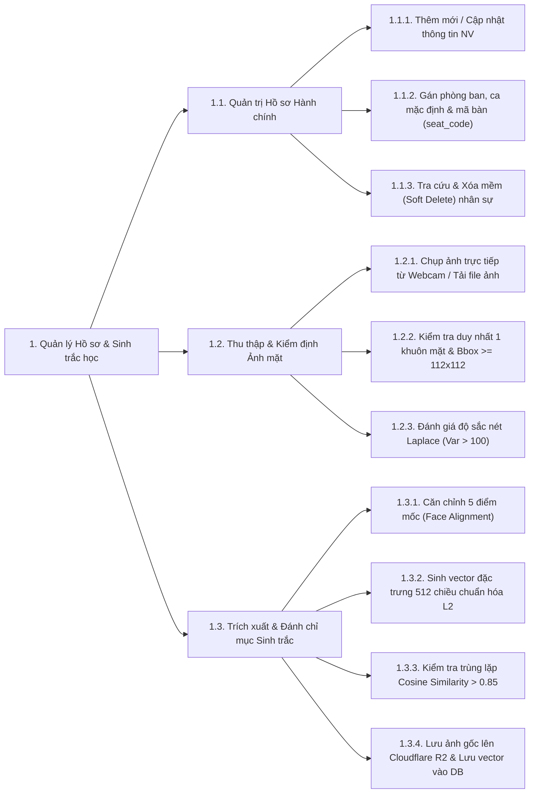
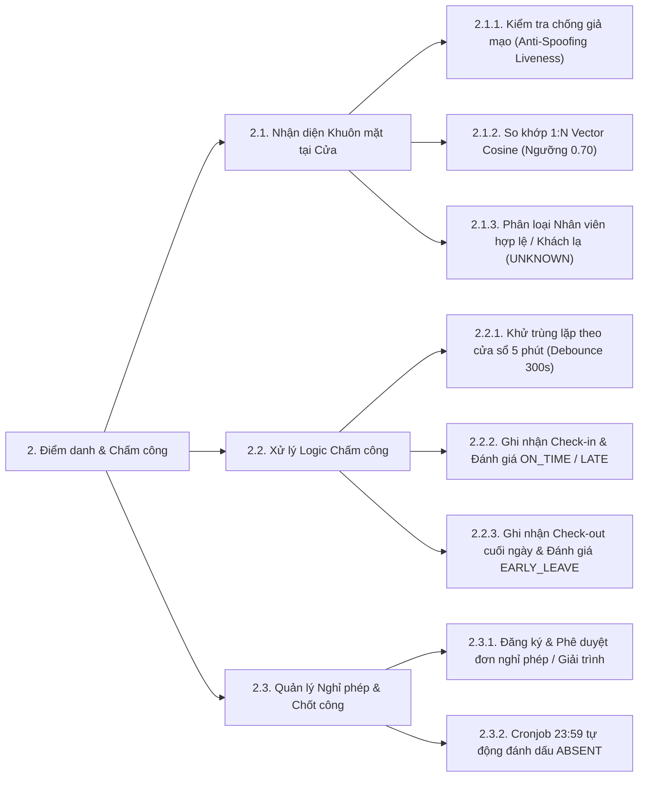
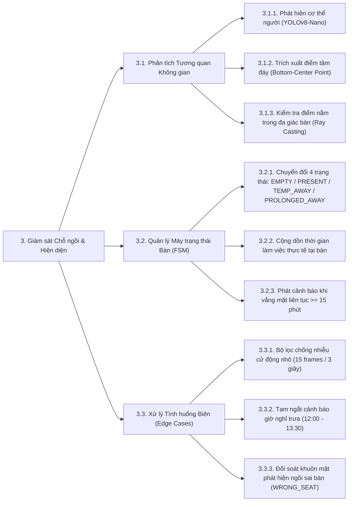
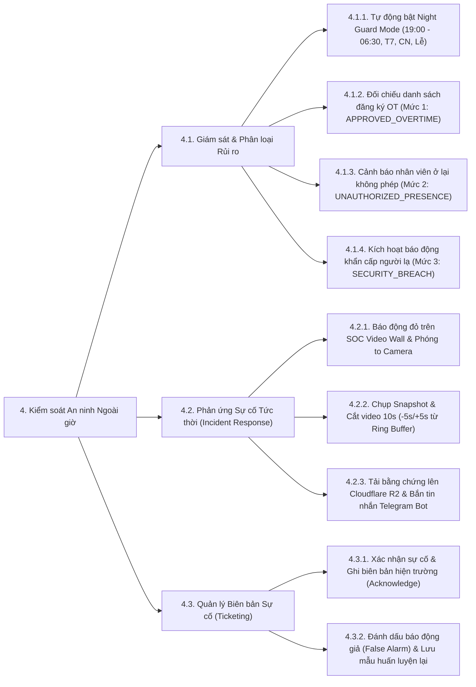
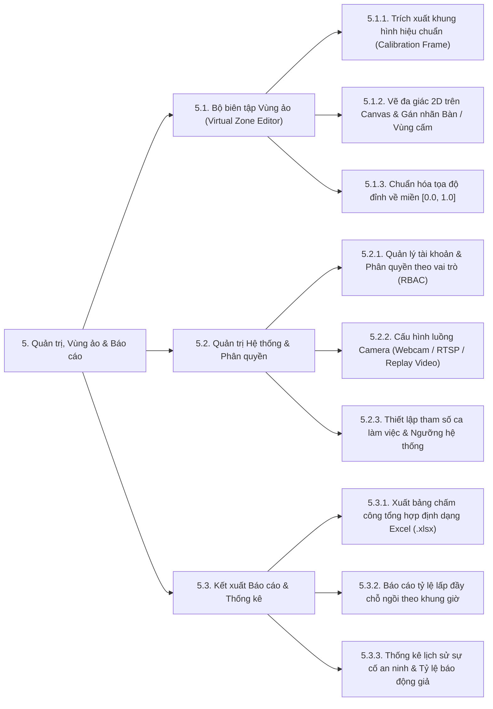

# SƠ ĐỒ PHÂN RÃ CHỨC NĂNG HỆ THỐNG (FUNCTIONAL DECOMPOSITION DIAGRAM - FDD)

> **Đề tài**: Hệ thống Thị giác Máy tính Giám sát Văn phòng Thông minh (Hỗ trợ Chấm công, Giám sát Hiện diện và An ninh Văn phòng)  
> **Tiêu chuẩn áp dụng**: Chuẩn đầu ra CLO2 – Phân tích & Thiết kế Hệ thống Thông tin  
> **Tài liệu liên quan**: [`01_YEU_CAU_HE_THONG.md`](./01_YEU_CAU_HE_THONG.md)

---

## 1. TỔNG QUAN PHÂN RÃ CHỨC NĂNG

Sơ đồ phân rã chức năng (*Functional Decomposition Diagram - FDD* hay *Work Breakdown Structure - WBS chức năng*) chia nhỏ hệ thống **Smart Office Computer Vision System** từ mức tổng quát (Mức 0) thành **5 phân hệ nghiệp vụ chính (Mức 1)** tương ứng 1-1 với kiến trúc **Modular Monolith** trên Backend C# .NET và **25 chức năng nghiệp vụ chi tiết (Mức 2 & Mức 3)**.

---

## 2. SƠ ĐỒ PHÂN RÃ CHỨC NĂNG TỔNG THỂ (MERMAID DIAGRAM)

```mermaid
flowchart TD
    ROOT["HỆ THỐNG THỊ GIÁC MÁY TÍNH GIÁM SÁT VĂN PHÒNG THÔNG MINH"]

    ROOT --> M1["1. Quản lý Hồ sơ & Sinh trắc học (Biometrics)"]
    ROOT --> M2["2. Điểm danh & Chấm công (Attendance)"]
    ROOT --> M3["3. Giám sát Chỗ ngồi & Hiện diện (Occupancy)"]
    ROOT --> M4["4. Kiểm soát An ninh Ngoài giờ (Security)"]
    ROOT --> M5["5. Quản trị Hệ thống, Vùng ảo & Báo cáo (Admin & Reporting)"]

    %% Nhánh 1: Biometrics
    M1 --> M1_1["1.1. Quản lý Hồ sơ Nhân sự (CRUD)"]
    M1 --> M1_2["1.2. Thu nhận Ảnh mẫu Khuôn mặt"]
    M1 --> M1_3["1.3. Kiểm định Chất lượng Ảnh (Laplace & Bbox)"]
    M1 --> M1_4["1.4. Trích xuất Vector 512 chiều (ArcFace L2)"]
    M1 --> M1_5["1.5. Kiểm tra Trùng lặp Sinh trắc (Cosine > 0.85)"]
    M1 --> M1_6["1.6. Lưu trữ Ảnh mẫu R2 & Đồng bộ Chỉ mục"]

    %% Nhánh 2: Attendance
    M2 --> M2_1["2.1. Kiểm tra Thực thể sống (Anti-Spoofing)"]
    M2 --> M2_2["2.2. Định danh Khuôn mặt 1:N (Threshold 0.70)"]
    M2 --> M2_3["2.3. Lọc trùng lặp Cửa sổ Thời gian (Debounce 5p)"]
    M2 --> M2_4["2.4. Chấm công Vào ca & Tính phút Đi muộn"]
    M2 --> M2_5["2.5. Chấm công Ra ca & Tính phút Về sớm"]
    M2 --> M2_6["2.6. Tự động Chốt vắng mặt Cuối ngày (23:59)"]

    %% Nhánh 3: Occupancy
    M3 --> M3_1["3.1. Phát hiện Người & Tọa độ Đáy (YOLOv8-Nano)"]
    M3 --> M3_2["3.2. Kiểm tra Đa giác Bàn (Point-in-Polygon)"]
    M3 --> M3_3["3.3. Máy trạng thái Chỗ ngồi 4 mức (4-State FSM)"]
    M3 --> M3_4["3.4. Lọc nhiễu Cử động nhỏ (15 frames / 3s)"]
    M3 --> M3_5["3.5. Tạm ngắt Giờ nghỉ trưa (Mute 12:00-13:30)"]
    M3 --> M3_6["3.6. Phát hiện Ngồi sai vị trí (Cross-Seating)"]

    %% Nhánh 4: Security
    M4 --> M4_1["4.1. Kích hoạt Chế độ Trực đêm (Night Guard Mode)"]
    M4 --> M4_2["4.2. Phân cấp Cảnh báo theo Cây quyết định (Mức 1-2-3)"]
    M4 --> M4_3["4.3. Báo động Trung tâm SOC & Phóng to Camera"]
    M4 --> M4_4["4.4. Đóng gói Bằng chứng Số (Snapshot + Clip 10s)"]
    M4 --> M4_5["4.5. Gửi Cảnh báo Khẩn cấp qua Telegram Bot"]
    M4 --> M4_6["4.6. Đóng Biên bản Xử lý Sự cố (Acknowledge / False Alarm)"]

    %% Nhánh 5: Admin & Reporting
    M5 --> M5_1["5.1. Thiết lập Đa giác Vùng ảo (Virtual Zone Editor)"]
    M5 --> M5_2["5.2. Cấu hình Ca làm việc & Tham số Ngưỡng"]
    M5 --> M5_3["5.3. Quản lý Tài khoản & Phân quyền RBAC"]
    M5 --> M5_4["5.4. Xuất Báo cáo Bảng công Excel (.xlsx)"]
    M5 --> M5_5["5.5. Thống kê Mật độ Hiện diện & Nhật ký An ninh"]
```

---

## 3. CHI TIẾT PHÂN RÃ TỪNG PHÂN HỆ (MỨC 1 $\rightarrow$ MỨC 3)

### 3.1. Phân hệ 1: Quản lý Hồ sơ & Đăng ký Sinh trắc học (`Biometrics Module`)

### 3.2. Phân hệ 2: Điểm danh, Chấm công & Quản lý Chuyên cần (`Attendance Module`)

### 3.3. Phân hệ 3: Giám sát Trạng thái Chỗ ngồi & Hiện diện (`Occupancy Module`)

### 3.4. Phân hệ 4: Kiểm soát An ninh Ngoài giờ & Phát hiện Người lạ (`Security Module`)

### 3.5. Phân hệ 5: Quản trị Hệ thống, Vùng ảo & Báo cáo (`Admin, Zone & Reporting Module`)

---

## 4. BẢNG ÁNH XẠ CHỨC NĂNG SANG CẤU TRÚC MÃ NGUỒN (TRACEABILITY MATRIX)

Bảng dưới đây thể hiện sự ánh xạ trực tiếp từ các nhánh trên **Sơ đồ phân rã chức năng** sang các **Module trong Backend C# .NET**, **Pipeline trong Python AI Service** và **Page trong React Frontend**:

| Nhánh Chức năng (FDD) | Module Backend C# .NET (`backend/src/Modules/`) | Tầng Xử lý AI Python (`ai_service/`) | Giao diện React (`frontend/src/pages/`) |
| :--- | :--- | :--- | :--- |
| **1. Quản lý Hồ sơ & Sinh trắc học** | `SmartOffice.Modules.Biometrics` | `core/quality.py` `core/face_engine.py` | `EmployeesPage.tsx` |
| **2. Điểm danh & Chấm công** | `SmartOffice.Modules.Attendance` | `core/anti_spoofing.py` `pipelines/gate_camera.py` | `AttendancePage.tsx` |
| **3. Giám sát Chỗ ngồi & Hiện diện** | `SmartOffice.Modules.Occupancy` | `core/person_detector.py` `core/geometry.py` `pipelines/desk_camera.py` | `SeatMapPage.tsx` |
| **4. Kiểm soát An ninh Ngoài giờ** | `SmartOffice.Modules.Security` | `core/ring_buffer.py` `pipelines/night_guard.py` | `SecurityPage.tsx` |
| **5. Quản trị, Vùng ảo & Báo cáo** | `SmartOffice.Modules.Reporting` `SmartOffice.Infrastructure` | API Calibration Frame | `ZoneEditorPage.tsx` `DashboardPage.tsx` |

