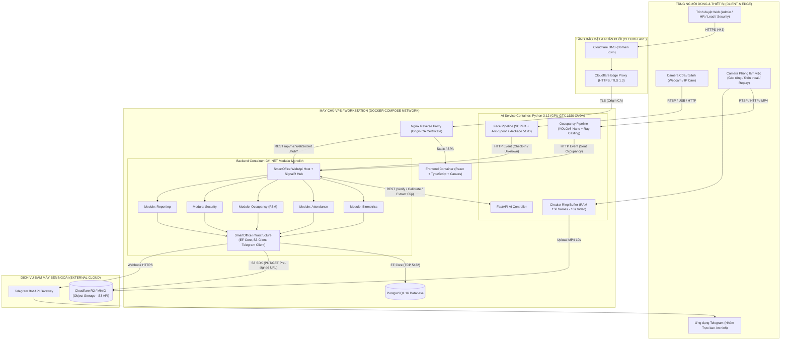
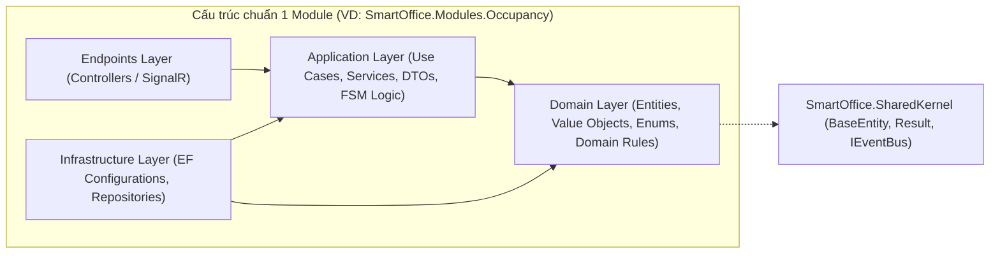
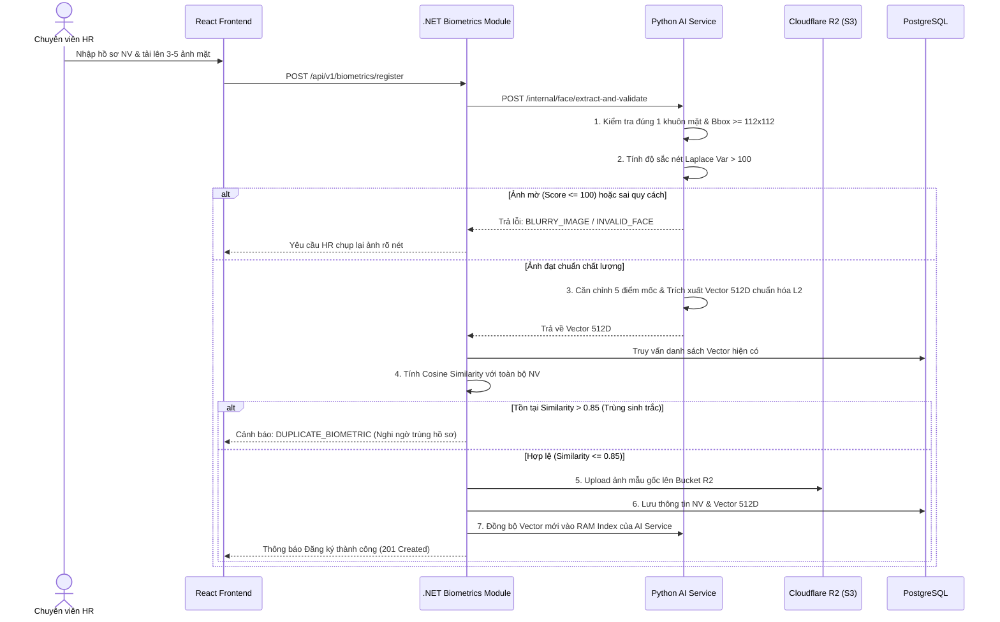
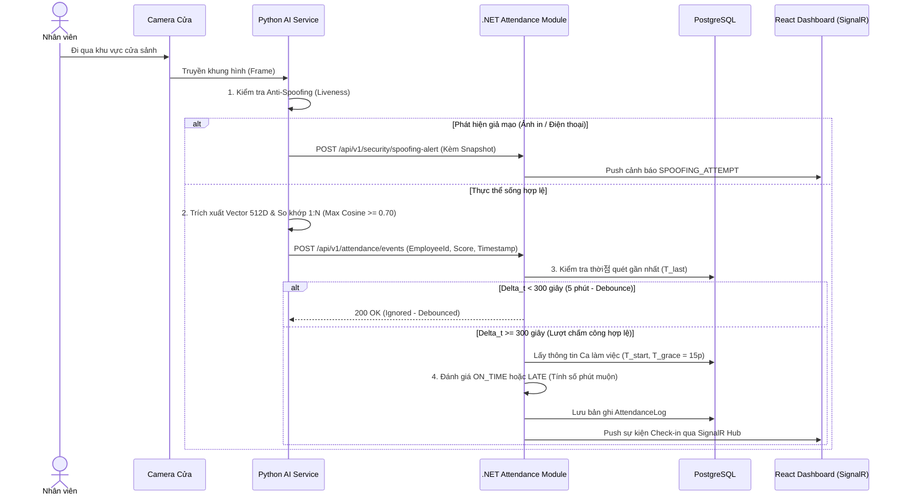
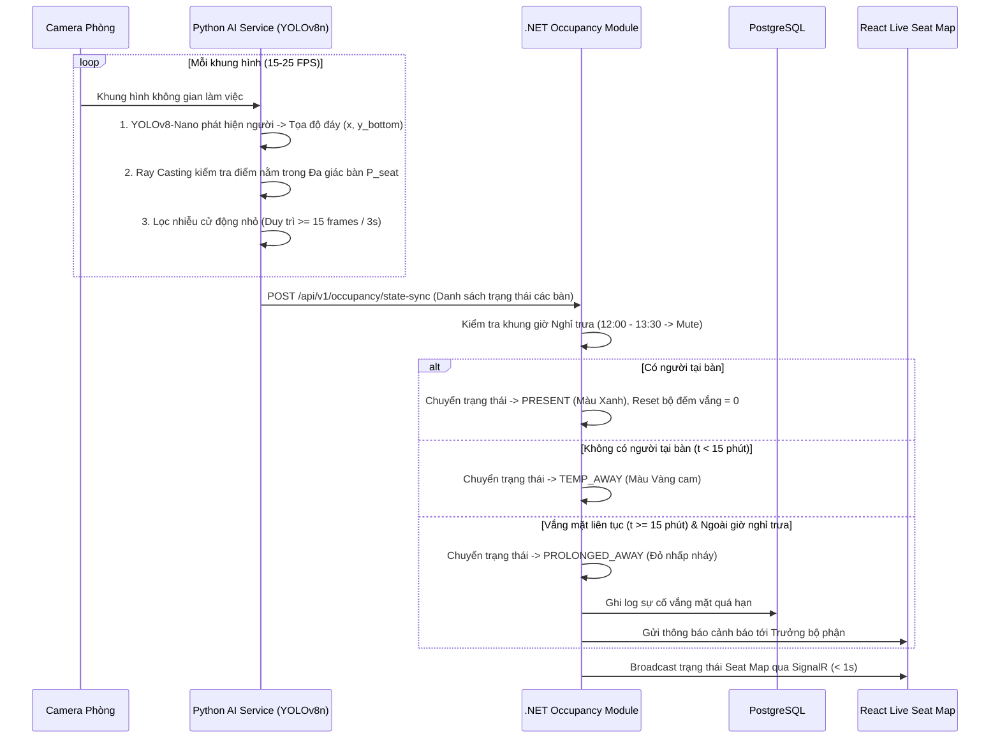
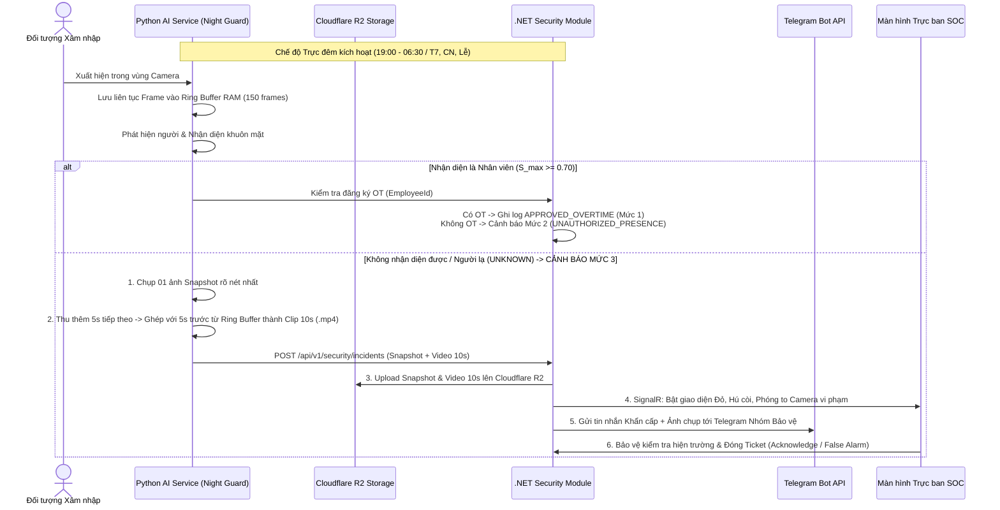
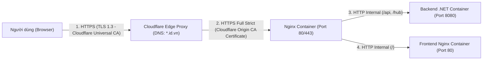
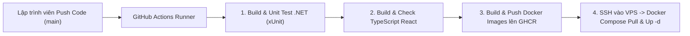

# THIẾT KẾ KIẾN TRÚC HỆ THỐNG (SYSTEM ARCHITECTURE DESIGN)

> **Đề tài**: Hệ thống Thị giác Máy tính Giám sát Văn phòng Thông minh (Hỗ trợ Chấm công, Giám sát Hiện diện và An ninh Văn phòng)  
> **Tiêu chuẩn áp dụng**: Chuẩn đầu ra CLO1 & CLO2 – Kiến trúc Modular Monolith, Docker Compose, Cloudflare R2/SSL & CI/CD  
> **Tài liệu liên quan**: [`01_YEU_CAU_HE_THONG.md`](./01_YEU_CAU_HE_THONG.md), [`02_SO_DO_PHAN_RA_CHUC_NANG.md`](./02_SO_DO_PHAN_RA_CHUC_NANG.md)

---

## 1. TỔNG QUAN KIẾN TRÚC HỆ THỐNG

Hệ thống được thiết kế theo mô hình **Hybrid Modular Monolith kết hợp Dedicated AI Worker**:

1. **Core Backend (`SmartOffice.WebApi` - C# .NET)**:
   - Áp dụng kiến trúc **Modular Monolith**: Toàn bộ nghiệp vụ quản trị, chấm công, máy trạng thái chỗ ngồi, an ninh và báo cáo được chia thành 5 module độc lập (`Biometrics`, `Attendance`, `Occupancy`, `Security`, `Reporting`), chạy chung trong một tiến trình `.NET` duy nhất.
   - Giảm thiểu độ trễ giao tiếp mạng nội bộ, đồng thời giữ ranh giới miền (*Domain Boundaries*) chặt chẽ để dễ dàng tách thành Microservices khi mở rộng quy mô.
2. **AI & Computer Vision Service (`ai_service` - Python)**:
   - Tách riêng thành một dịch vụ chuyên biệt sử dụng **PyTorch CUDA**, **InsightFace (ArcFace 512D)**, **YOLOv8-Nano** và **OpenCV** chạy trên GPU **NVIDIA GeForce GTX 1650**.
   - Đảm nhận việc đọc luồng video thời gian thực (Webcam / RTSP / Replay Video), suy luận AI và gửi sự kiện đã tinh lọc sang Backend C# .NET.
3. **Frontend Dashboard (`frontend` - React + TypeScript)**:
   - Ứng dụng đơn trang (SPA) cung cấp công cụ vẽ đa giác bàn làm việc (*Virtual Zone Editor* trên HTML5 Canvas), sơ đồ văn phòng thời gian thực (*Live Seat Map*) và màn hình giám sát an ninh (*SOC Video Wall*) nhận dữ liệu tức thời qua **SignalR WebSocket**.
4. **Hạ tầng Lưu trữ & Đám mây**:
   - **PostgreSQL 16**: Lưu trữ dữ liệu giao dịch có cấu trúc và vector sinh trắc học.
   - **Cloudflare R2 (tương thích S3 API)**: Lưu trữ đám mây (10GB miễn phí) cho ảnh mẫu khuôn mặt, ảnh chụp vi phạm và video bằng chứng 10 giây.
   - **Cloudflare DNS & Full (Strict) SSL**: Bảo mật tên miền `.id.vn` từ trình duyệt tới máy chủ VPS.

---

## 2. SƠ ĐỒ KIẾN TRÚC TỔNG THỂ (HIGH-LEVEL ARCHITECTURE DIAGRAM)

---

## 3. KIẾN TRÚC NỘI BỘ BACKEND C# .NET (MODULAR MONOLITH)

Mỗi module trong thư mục `backend/src/Modules/` tuân thủ nghiêm ngặt kiến trúc **Clean Architecture** gồm 4 lớp:

### Nguyên tắc giao tiếp giữa các Module:
1. **Cô lập dữ liệu (Database Isolation)**: Mỗi module quản lý nhóm bảng (Entities) riêng thông qua cấu hình schema/table prefix trong EF Core. Không một module nào được phép truy vấn trực tiếp `DbSet` nội bộ của module khác.
2. **Giao tiếp qua Hợp đồng (Contract / In-Process Event Bus)**:
   - Khi `Attendance Module` ghi nhận nhân viên A đã Check-in vào ca sáng, nó phát một sự kiện nội bộ `EmployeeCheckedInEvent`.
   - `Occupancy Module` lắng nghe sự kiện này để kích hoạt theo dõi vị trí bàn làm việc của nhân viên A từ trạng thái `EMPTY` sang chờ `PRESENT`.

---

## 4. SƠ ĐỒ TUẦN TỰ CÁC LUỒNG NGHIỆP VỤ TRỌNG TÂM (SEQUENCE DIAGRAMS)

### 4.1. Luồng 1: Đăng ký Khuôn mặt & Kiểm tra Trùng lặp Sinh trắc

---

### 4.2. Luồng 2: Điểm danh Vào ca Không chạm (Check-in & Debounce 5 phút)

---

### 4.3. Luồng 3: Giám sát Chỗ ngồi Thời gian thực (4-State FSM)

---

### 4.4. Luồng 4: Kiểm soát An ninh Ngoài giờ & Đóng gói Bằng chứng Số 10s

---

## 5. THIẾT KẾ TRIỂN KHAI HẠ TẦNG, MẠNG & CI/CD (DEPLOYMENT VIEW)

### 5.1. Mô hình Bảo mật SSL/TLS qua Cloudflare và Nginx VPS

### 5.2. Quy trình Tự động hóa CI/CD (GitHub Actions)

---

## 6. BẢNG TỔNG HỢP CÔNG NGHỆ SỬ DỤNG TRONG HỆ THỐNG

| Tầng (Layer) | Thành phần Kỹ thuật | Phiên bản / Công nghệ | Lý do lựa chọn cho Đồ án |
| :--- | :--- | :--- | :--- |
| **Backend Core** | Framework & Runtime | **C# .NET 10 / 9 (ASP.NET Core WebAPI)** | Hiệu năng cực cao, hỗ trợ hoàn hảo kiến trúc Modular Monolith, kiểu dữ liệu chặt chẽ. |
| **Real-time** | Giao thức thời gian thực | **ASP.NET Core SignalR** | Đồng bộ trạng thái bàn làm việc và báo động đỏ dưới 1 giây qua WebSockets. |
| **AI Service** | Thị giác máy tính | **Python 3.12 + FastAPI + OpenCV** | Tận dụng hệ sinh thái AI chuẩn công nghiệp trên card rời NVIDIA GTX 1650 (CUDA). |
| **Model Khuôn mặt** | Face Recognition | **InsightFace (SCRFD + ArcFace 512D)** | Độ chính xác hàng đầu thế giới, trích xuất vector chuẩn hóa $L_2$ nhanh và ổn định. |
| **Model Phát hiện người** | Object Detection | **Ultralytics YOLOv8-Nano / YOLO11-Nano** | Mô hình siêu nhẹ (~6MB), đạt 25+ FPS dễ dàng trên GTX 1650 4GB VRAM. |
| **Frontend** | Giao diện Quản trị | **React + TypeScript (Vite) + HTML5 Canvas** | Tương tác vẽ đa giác mượt mà, cập nhật DOM thời gian thực không giật lag. |
| **Database** | Cơ sở dữ liệu quan hệ | **PostgreSQL 16 + Entity Framework Core** | Hỗ trợ lưu trữ JSONB (cho tọa độ đa giác bàn) và mảng số thực hiệu quả. |
| **Object Storage** | Lưu trữ tệp đa phương tiện | **Cloudflare R2 (AWS S3 SDK) / MinIO** | Miễn phí 10GB lưu trữ và miễn phí băng thông tải ra (Zero Egress Fee). |
| **Cloud & DevOps** | Đóng gói & Triển khai | **Docker Compose + Nginx + Cloudflare + GitHub Actions** | Đảm bảo chuẩn đầu ra CLO1, tự động hóa hoàn toàn từ lúc code đến lúc lên VPS. |

