# THIẾT KẾ CƠ SỞ DỮ LIỆU & SƠ ĐỒ QUAN HỆ THỰC THỂ (DATABASE DESIGN & ERD)

> **Đề tài**: Hệ thống Thị giác Máy tính Giám sát Văn phòng Thông minh (Hỗ trợ Chấm công, Giám sát Hiện diện và An ninh Văn phòng)  
> **Hệ quản trị CSDL**: PostgreSQL 16 (ORM: Entity Framework Core trên C# .NET) + Lưu trữ Object Storage Cloudflare R2 (S3)  
> **Tiêu chuẩn áp dụng**: Chuẩn đầu ra CLO1 & CLO2 – Thiết kế CSDL cho kiến trúc Modular Monolith  
> **Tài liệu liên quan**: [`01_YEU_CAU_HE_THONG.md`](./01_YEU_CAU_HE_THONG.md), [`03_THIET_KE_HE_THONG.md`](./03_THIET_KE_HE_THONG.md)

---

## 1. TỔNG QUAN THIẾT KẾ CƠ SỞ DỮ LIỆU

Cơ sở dữ liệu của hệ thống sử dụng **PostgreSQL 16** kết hợp với kho lưu trữ đối tượng đám mây **Cloudflare R2 (tương thích chuẩn S3)**:
* **Dữ liệu có cấu trúc & Vector đặc trưng**: Lưu trong PostgreSQL (sử dụng kiểu `float4[]` / `jsonb` hoặc extension `pgvector` cho vector khuôn mặt 512 chiều $\vec{v} \in \mathbb{R}^{512}$ và mảng tọa độ đa giác bàn làm việc $\mathcal{P}_{\text{seat}}$).
* **Dữ liệu phi cấu trúc (Media Files)**: Ảnh chân dung gốc, ảnh snapshot chấm công, ảnh phát hiện giả mạo và đoạn video bằng chứng 10 giây (`.mp4`) được lưu trên **Cloudflare R2**, trong CSDL chỉ lưu khóa đường dẫn định danh (`object_key`).
* **Phân vùng theo Module (Modular Monolith Schema)**: Các bảng được nhóm rõ ràng theo 5 miền nghiệp vụ:
  1. **Core & RBAC**: `departments`, `users`, `cameras`
  2. **Biometrics Module**: `employees`, `biometric_vectors`
  3. **Attendance Module**: `shifts`, `attendance_logs`, `leave_requests`
  4. **Occupancy Module**: `seats` (*Virtual Zones*), `seat_occupancy_logs`
  5. **Security Module**: `ot_registrations`, `security_incidents`

---

## 2. SƠ ĐỒ QUAN HỆ THỰC THỂ TỔNG THỂ (ERD - MERMAID DIAGRAM)

```mermaid
erDiagram
    DEPARTMENTS ||--o{ USERS : "co_quan_ly"
    DEPARTMENTS ||--o{ EMPLOYEES : "truc_thuoc"
    DEPARTMENTS ||--o{ SEATS : "so_huu_khu_vuc"

    SHIFTS ||--o{ EMPLOYEES : "ap_dung_ca_mac_dinh"
    SHIFTS ||--o{ ATTENDANCE_LOGS : "doi_chieu_ca"

    EMPLOYEES ||--o{ BIOMETRIC_VECTORS : "co_mau_khuon_mat"
    EMPLOYEES ||--o| SEATS : "duoc_phan_bo_ban"
    EMPLOYEES ||--o{ ATTENDANCE_LOGS : "ghi_nhan_cham_cong"
    EMPLOYEES ||--o{ LEAVE_REQUESTS : "dang_ky_nghi_phep"
    EMPLOYEES ||--o{ OT_REGISTRATIONS : "dang_ky_tang_ca"
    EMPLOYEES ||--o{ SEAT_OCCUPANCY_LOGS : "hien_dien_tai_ban"
    EMPLOYEES ||--o{ SECURITY_INCIDENTS : "lien_quan_su_co"

    CAMERAS ||--o{ SEATS : "quan_sat_vung_ao"
    CAMERAS ||--o{ ATTENDANCE_LOGS : "quet_tai_cua"
    CAMERAS ||--o{ SECURITY_INCIDENTS : "ghi_nhan_xam_nhap"

    SEATS ||--o{ SEAT_OCCUPANCY_LOGS : "lich_su_trang_thai_FSM"
    USERS ||--o{ SECURITY_INCIDENTS : "xu_ly_dong_ticket"

    DEPARTMENTS {
        uuid id PK
        varchar code UK "Mã phòng ban (IT, HR, FIN)"
        varchar name "Tên phòng ban"
        timestamp created_at
    }

    USERS {
        uuid id PK
        varchar username UK
        varchar password_hash "BCrypt Hash"
        varchar full_name
        varchar role "ADMIN | HR | DEPT_LEAD | SECURITY"
        uuid department_id FK "Null nếu là Admin/HR/Security"
        boolean is_active
        timestamp created_at
    }

    CAMERAS {
        uuid id PK
        varchar camera_code UK "CAM_GATE_01, CAM_DESK_01"
        varchar name "Tên vị trí lắp đặt"
        varchar camera_type "GATE_FACE | DESK_AREA"
        varchar stream_source "RTSP URL / Webcam Index / MP4 Path"
        varchar calibration_frame_key "Ảnh chuẩn trên R2 để vẽ vùng ảo"
        boolean is_active
    }

    SHIFTS {
        uuid id PK
        varchar shift_code UK "SHIFT_MORNING, SHIFT_ADMIN"
        varchar name "Ca hành chính"
        time start_time "T_start (VD: 08:00:00)"
        time end_time "T_end (VD: 17:30:00)"
        int grace_minutes "T_grace (Mặc định: 15 phút)"
        time lunch_start "12:00:00"
        time lunch_end "13:30:00"
    }

    EMPLOYEES {
        uuid id PK
        varchar employee_code UK "Mã NV (VD: NV001)"
        varchar full_name "Họ và tên"
        varchar email UK
        varchar phone
        uuid department_id FK
        uuid default_shift_id FK
        varchar avatar_object_key "Ảnh đại diện trên R2"
        boolean is_active "Xóa mềm (Soft delete)"
        timestamp created_at
    }

    BIOMETRIC_VECTORS {
        uuid id PK
        uuid employee_id FK
        float4_array embedding_vector "Vector 512 chiều chuẩn hóa L2"
        varchar sample_image_key "Ảnh mẫu gốc trên Cloudflare R2"
        float laplace_blur_score "Điểm sắc nét Var > 100"
        varchar pose_angle "FRONT | LEFT | RIGHT"
        timestamp created_at
    }

    SEATS {
        uuid id PK
        varchar seat_code UK "Mã bàn / vùng (VD: SEAT_IT_01)"
        varchar zone_type "WORK_DESK | RESTRICTED_ZONE"
        uuid camera_id FK
        uuid department_id FK
        uuid assigned_employee_id FK "Nhân viên sở hữu bàn"
        jsonb polygon_points "Mảng đỉnh chuẩn hóa [0.0, 1.0]: [{x,y},...]"
        varchar current_state "EMPTY | PRESENT | TEMP_AWAY | PROLONGED_AWAY | WRONG_SEAT"
        timestamp state_updated_at
    }

    ATTENDANCE_LOGS {
        uuid id PK
        uuid employee_id FK
        uuid shift_id FK
        uuid gate_camera_id FK
        date work_date "Ngày chấm công"
        timestamp check_in_time "T_in (Lượt quét đầu ngày)"
        timestamp check_out_time "T_out (Lượt quét cuối ngày)"
        timestamp last_seen_time "Dùng tính Debounce 300 giây"
        varchar status "ON_TIME | LATE | EARLY_LEAVE | ABSENT"
        int late_minutes "M_late (Số phút đi muộn)"
        int early_leave_minutes "M_early (Số phút về sớm)"
        float match_similarity "Điểm Cosine S_max >= 0.70"
        varchar checkin_snapshot_key "Ảnh bằng chứng trên R2"
    }

    LEAVE_REQUESTS {
        uuid id PK
        uuid employee_id FK
        date start_date
        date end_date
        varchar reason
        varchar approval_status "PENDING | APPROVED | REJECTED"
        uuid approved_by_user_id FK
    }

    SEAT_OCCUPANCY_LOGS {
        uuid id PK
        uuid seat_id FK
        uuid detected_employee_id FK "Null nếu chưa định danh mặt"
        varchar previous_state "Trạng thái trước"
        varchar new_state "EMPTY | PRESENT | TEMP_AWAY | PROLONGED_AWAY | WRONG_SEAT"
        int duration_seconds "Thời gian duy trì trạng thái"
        timestamp recorded_at
    }

    OT_REGISTRATIONS {
        uuid id PK
        uuid employee_id FK
        date ot_date "Ngày đăng ký tăng ca"
        time start_time "VD: 19:00:00"
        time end_time "VD: 22:00:00"
        varchar approval_status "APPROVED | REJECTED"
        uuid approved_by_user_id FK
    }

    SECURITY_INCIDENTS {
        uuid id PK
        uuid camera_id FK
        uuid detected_employee_id FK "Null nếu là UNKNOWN / Người lạ"
        varchar alert_level "LEVEL_1_OT | LEVEL_2_UNAUTH_OT | LEVEL_3_BREACH | SPOOFING_ATTEMPT"
        varchar incident_type "UNKNOWN_INTRUDER | UNAUTHORIZED_OT | RESTRICTED_ZONE | ANTI_SPOOFING"
        varchar snapshot_object_key "Ảnh chụp rõ nét nhất trên R2"
        varchar video_clip_object_key "Video bằng chứng 10s (-5s/+5s) trên R2"
        boolean telegram_sent "Đã gửi cảnh báo Telegram"
        varchar ticket_status "OPEN | ACKNOWLEDGED | FALSE_ALARM"
        text resolution_note "Biên bản xử lý của nhân viên an ninh"
        uuid resolved_by_user_id FK
        timestamp detected_at
        timestamp resolved_at
    }
```



---

## 3. ĐẶC TẢ CHI TIẾT CÁC BẢNG DỮ LIỆU (DATA DICTIONARY)

### 3.1. Nhóm Quản trị Hệ thống & Phân quyền (`Core & RBAC`)

#### Bảng 1: `departments` (Danh mục Phòng ban)
| Tên cột | Kiểu dữ liệu | Ràng buộc | Mô tả chi tiết |
| :--- | :--- | :--- | :--- |
| `id` | `UUID` | `PK` | Khóa chính tự sinh (`gen_random_uuid()`). |
| `code` | `VARCHAR(20)` | `UNIQUE, NOT NULL` | Mã phòng ban (VD: `DEPT_IT`, `DEPT_HR`, `DEPT_FIN`). |
| `name` | `VARCHAR(100)` | `NOT NULL` | Tên phòng ban (VD: Phòng Kỹ thuật, Phòng Nhân sự). |
| `created_at` | `TIMESTAMPTZ` | `NOT NULL` | Thời điểm khởi tạo bản ghi. |

#### Bảng 2: `users` (Tài khoản Quản trị & Vận hành Hệ thống)
| Tên cột | Kiểu dữ liệu | Ràng buộc | Mô tả chi tiết |
| :--- | :--- | :--- | :--- |
| `id` | `UUID` | `PK` | Khóa chính. |
| `username` | `VARCHAR(50)` | `UNIQUE, NOT NULL` | Tên đăng nhập hệ thống. |
| `password_hash` | `VARCHAR(255)` | `NOT NULL` | Chuỗi mật khẩu đã băm bằng thuật toán `BCrypt`. |
| `full_name` | `VARCHAR(100)` | `NOT NULL` | Họ và tên người dùng vận hành. |
| `role` | `VARCHAR(30)` | `NOT NULL` | Vai trò theo RBAC Matrix: `ADMIN`, `HR`, `DEPT_LEAD`, `SECURITY`. |
| `department_id` | `UUID` | `FK -> departments.id` | Bắt buộc có giá trị nếu `role = DEPT_LEAD` để giới hạn phạm vi xem dữ liệu. |
| `is_active` | `BOOLEAN` | `DEFAULT TRUE` | Trạng thái kích hoạt tài khoản. |

#### Bảng 3: `cameras` (Cấu hình Nguồn Camera)
| Tên cột | Kiểu dữ liệu | Ràng buộc | Mô tả chi tiết |
| :--- | :--- | :--- | :--- |
| `id` | `UUID` | `PK` | Khóa chính. |
| `camera_code` | `VARCHAR(30)` | `UNIQUE, NOT NULL` | Mã định danh camera (VD: `CAM_GATE_01`, `CAM_OFFICE_01`). |
| `name` | `VARCHAR(100)` | `NOT NULL` | Tên hiển thị vị trí camera (VD: Camera Sảnh chính, Camera Phòng IT). |
| `camera_type` | `VARCHAR(20)` | `NOT NULL` | Loại luồng xử lý AI: `GATE_FACE` (Điểm danh cửa) hoặc `DESK_AREA` (Giám sát phòng). |
| `stream_source` | `VARCHAR(500)` | `NOT NULL` | Nguồn phát: Index webcam (`0`), URL điện thoại/RTSP (`http://192.168.1.x:4747/video`), hoặc đường dẫn video kịch bản (`mock_videos/demo.mp4`). |
| `calibration_frame_key` | `VARCHAR(255)` | `NULLABLE` | Đường dẫn ảnh khung hình chuẩn trên R2 phục vụ vẽ đa giác vùng ảo. |
| `is_active` | `BOOLEAN` | `DEFAULT TRUE` | Trạng thái hoạt động của camera. |

---

### 3.2. Nhóm Phân hệ Quản lý Hồ sơ & Sinh trắc học (`Biometrics Module`)

#### Bảng 4: `employees` (Hồ sơ Nhân viên Doanh nghiệp)
| Tên cột | Kiểu dữ liệu | Ràng buộc | Mô tả chi tiết |
| :--- | :--- | :--- | :--- |
| `id` | `UUID` | `PK` | Khóa chính. |
| `employee_code` | `VARCHAR(20)` | `UNIQUE, NOT NULL` | Mã nhân viên duy nhất (VD: `NV001`, `NV002`). |
| `full_name` | `VARCHAR(100)` | `NOT NULL` | Họ và tên nhân viên. |
| `email` | `VARCHAR(150)` | `UNIQUE, NULLABLE` | Địa chỉ email công ty. |
| `department_id` | `UUID` | `FK -> departments.id` | Phòng ban trực thuộc. |
| `default_shift_id` | `UUID` | `FK -> shifts.id` | Ca làm việc mặc định áp dụng cho nhân viên. |
| `avatar_object_key` | `VARCHAR(255)` | `NULLABLE` | Khóa ảnh chân dung đại diện lưu trên Cloudflare R2. |
| `is_active` | `BOOLEAN` | `DEFAULT TRUE` | Cờ xóa mềm (`FALSE` khi nhân viên nghỉ việc). |
| `created_at` | `TIMESTAMPTZ` | `NOT NULL` | Ngày tạo hồ sơ. |

#### Bảng 5: `biometric_vectors` (Dữ liệu Vector Đặc trưng Khuôn mặt 512 chiều)
| Tên cột | Kiểu dữ liệu | Ràng buộc | Mô tả chi tiết |
| :--- | :--- | :--- | :--- |
| `id` | `UUID` | `PK` | Khóa chính. |
| `employee_id` | `UUID` | `FK -> employees.id` | Liên kết tới nhân viên sở hữu mẫu sinh trắc (1 NV có 3–5 mẫu). |
| `embedding_vector` | `REAL[512]` | `NOT NULL` | Mảng 512 số thực chuẩn hóa $\vec{v} \in \mathbb{R}^{512}$ với $\|\vec{v}\|_2 = 1$. |
| `sample_image_key` | `VARCHAR(255)` | `NOT NULL` | Đường dẫn tệp ảnh mẫu gốc lưu trên Cloudflare R2. |
| `laplace_blur_score` | `REAL` | `CHECK (> 100)` | Điểm đánh giá độ sắc nét $\text{Var}(\nabla^2 I) > 100$ lúc đăng ký. |
| `pose_angle` | `VARCHAR(20)` | `DEFAULT 'FRONT'` | Góc chụp khuôn mặt (`FRONT`, `SLIGHT_LEFT`, `SLIGHT_RIGHT`). |
| `created_at` | `TIMESTAMPTZ` | `NOT NULL` | Thời điểm trích xuất vector. |

---

### 3.3. Nhóm Phân hệ Điểm danh & Chấm công (`Attendance Module`)

#### Bảng 6: `shifts` (Cấu hình Ca làm việc)
| Tên cột | Kiểu dữ liệu | Ràng buộc | Mô tả chi tiết |
| :--- | :--- | :--- | :--- |
| `id` | `UUID` | `PK` | Khóa chính. |
| `shift_code` | `VARCHAR(20)` | `UNIQUE, NOT NULL` | Mã ca làm việc (VD: `HC_01`). |
| `name` | `VARCHAR(100)` | `NOT NULL` | Tên ca làm việc (VD: Ca Hành chính 08:00 - 17:30). |
| `start_time` | `TIME` | `NOT NULL` | Giờ bắt đầu ca quy định $T_{\text{start}}$ (`08:00:00`). |
| `end_time` | `TIME` | `NOT NULL` | Giờ kết thúc ca quy định $T_{\text{end}}$ (`17:30:00`). |
| `grace_minutes` | `INT` | `DEFAULT 15` | Thời gian ân hạn đi muộn $T_{\text{grace}}$ (mặc định 15 phút). |
| `lunch_start` | `TIME` | `DEFAULT '12:00:00'` | Giờ bắt đầu nghỉ trưa (dùng để Mute cảnh báo chỗ ngồi). |
| `lunch_end` | `TIME` | `DEFAULT '13:30:00'` | Giờ kết thúc nghỉ trưa. |

#### Bảng 7: `attendance_logs` (Nhật ký Điểm danh & Chấm công Hàng ngày)
| Tên cột | Kiểu dữ liệu | Ràng buộc | Mô tả chi tiết |
| :--- | :--- | :--- | :--- |
| `id` | `UUID` | `PK` | Khóa chính. |
| `employee_id` | `UUID` | `FK -> employees.id` | Mã định danh nhân viên. |
| `shift_id` | `UUID` | `FK -> shifts.id` | Ca làm việc áp dụng trong ngày. |
| `gate_camera_id` | `UUID` | `FK -> cameras.id` | Camera cửa ghi nhận sự kiện. |
| `work_date` | `DATE` | `NOT NULL` | Ngày làm việc (Unique kết hợp với `employee_id`). |
| `check_in_time` | `TIMESTAMPTZ` | `NULLABLE` | Giờ vào ca hợp lệ đầu tiên trong ngày ($T_{\text{in}}$). |
| `check_out_time` | `TIMESTAMPTZ` | `NULLABLE` | Giờ ra về hợp lệ cuối cùng trong ngày ($T_{\text{out}}$). |
| `last_seen_time` | `TIMESTAMPTZ` | `NULLABLE` | Mốc quét gần nhất $T_{\text{last\_recorded}}$ để kiểm tra Debounce $\Delta t \ge 300\text{s}$. |
| `status` | `VARCHAR(20)` | `NOT NULL` | Trạng thái chuyên cần: `ON_TIME`, `LATE`, `EARLY_LEAVE`, `LATE_AND_EARLY`, `ABSENT`. |
| `late_minutes` | `INT` | `DEFAULT 0` | Số phút đi muộn: $M_{\text{late}} = \lceil (T_{\text{in}} - T_{\text{start}})/60 \rceil$. |
| `early_leave_minutes` | `INT` | `DEFAULT 0` | Số phút về sớm: $M_{\text{early}} = \lceil (T_{\text{end}} - T_{\text{out}})/60 \rceil$. |
| `match_similarity` | `REAL` | `NULLABLE` | Độ tương đồng Cosine $S_{\max} \ge 0.70$. |
| `checkin_snapshot_key`| `VARCHAR(255)` | `NULLABLE` | Ảnh chụp bằng chứng lúc check-in lưu trên Cloudflare R2 (phục vụ đối soát). |

---

### 3.4. Nhóm Phân hệ Giám sát Chỗ ngồi & Vùng ảo (`Occupancy & Zone Module`)

#### Bảng 8: `seats` (Vị trí Bàn làm việc & Đa giác Vùng ảo)
| Tên cột | Kiểu dữ liệu | Ràng buộc | Mô tả chi tiết |
| :--- | :--- | :--- | :--- |
| `id` | `UUID` | `PK` | Khóa chính. |
| `seat_code` | `VARCHAR(30)` | `UNIQUE, NOT NULL` | Mã vị trí chỗ ngồi hoặc vùng cấm (VD: `SEAT_A01`, `ZONE_SERVER`). |
| `zone_type` | `VARCHAR(30)` | `NOT NULL` | Phân loại vùng: `WORK_DESK` (Bàn làm việc) hoặc `RESTRICTED_ZONE` (Khu vực cấm). |
| `camera_id` | `UUID` | `FK -> cameras.id` | Camera giám sát chứa vùng đa giác này. |
| `department_id` | `UUID` | `FK -> departments.id` | Phòng ban quản lý vị trí bàn. |
| `assigned_employee_id`| `UUID` | `FK -> employees.id` | Nhân viên được phân bổ ngồi cố định tại bàn này (`NULL` nếu bàn trống). |
| `polygon_points` | `JSONB` | `NOT NULL` | Danh sách đỉnh đa giác chuẩn hóa $[0.0, 1.0]$:<br>`[{"x": 0.12, "y": 0.45}, {"x": 0.28, "y": 0.45}, ...]` |
| `current_state` | `VARCHAR(20)` | `DEFAULT 'EMPTY'` | Trạng thái FSM hiện tại: `EMPTY`, `PRESENT`, `TEMP_AWAY`, `PROLONGED_AWAY`, `WRONG_SEAT`. |
| `active_seconds_today`| `INT` | `DEFAULT 0` | Tổng thời gian làm việc tích cực cộng dồn trong ngày ($\Delta t_{\text{active}}$). |
| `state_updated_at` | `TIMESTAMPTZ` | `NOT NULL` | Thời điểm chuyển trạng thái gần nhất (dùng tính ngưỡng vắng $t \ge 15\text{ phút}$). |

#### Bảng 9: `seat_occupancy_logs` (Lịch sử Chuyển đổi Trạng thái Chỗ ngồi)
| Tên cột | Kiểu dữ liệu | Ràng buộc | Mô tả chi tiết |
| :--- | :--- | :--- | :--- |
| `id` | `UUID` | `PK` | Khóa chính. |
| `seat_id` | `UUID` | `FK -> seats.id` | Bàn làm việc xảy ra chuyển đổi trạng thái. |
| `detected_employee_id`| `UUID` | `FK -> employees.id` | Nhân viên được nhận diện tại bàn (dùng khi phát hiện `WRONG_SEAT`). |
| `previous_state` | `VARCHAR(20)` | `NOT NULL` | Trạng thái trước khi chuyển đổi. |
| `new_state` | `VARCHAR(20)` | `NOT NULL` | Trạng thái mới (`PRESENT`, `TEMP_AWAY`, `PROLONGED_AWAY`, `WRONG_SEAT`). |
| `duration_seconds` | `INT` | `DEFAULT 0` | Thời gian duy trì ở trạng thái trước đó (tính bằng giây). |
| `recorded_at` | `TIMESTAMPTZ` | `NOT NULL` | Thời điểm ghi nhận sự kiện. |

---

### 3.5. Nhóm Phân hệ Kiểm soát An ninh Ngoài giờ (`Security Module`)

#### Bảng 10: `ot_registrations` (Danh sách Đăng ký Làm thêm giờ - Overtime)
| Tên cột | Kiểu dữ liệu | Ràng buộc | Mô tả chi tiết |
| :--- | :--- | :--- | :--- |
| `id` | `UUID` | `PK` | Khóa chính. |
| `employee_id` | `UUID` | `FK -> employees.id` | Nhân viên đăng ký làm thêm giờ. |
| `ot_date` | `DATE` | `NOT NULL` | Ngày làm thêm ngoài giờ hoặc ngày nghỉ cuối tuần/lễ. |
| `start_time` | `TIME` | `NOT NULL` | Giờ bắt đầu OT được phép (VD: `19:00:00`). |
| `end_time` | `TIME` | `NOT NULL` | Giờ kết thúc OT dự kiến (VD: `21:30:00`). |
| `approval_status` | `VARCHAR(20)` | `DEFAULT 'APPROVED'` | Trạng thái phê duyệt (`PENDING`, `APPROVED`, `REJECTED`). |
| `approved_by_user_id`| `UUID` | `FK -> users.id` | Quản lý/HR phê duyệt. |

#### Bảng 11: `security_incidents` (Sự cố An ninh Ngoài giờ & Biên bản Xử lý)
| Tên cột | Kiểu dữ liệu | Ràng buộc | Mô tả chi tiết |
| :--- | :--- | :--- | :--- |
| `id` | `UUID` | `PK` | Khóa chính (Mã Ticket sự cố). |
| `camera_id` | `UUID` | `FK -> cameras.id` | Camera phát hiện xâm nhập hoặc vi phạm. |
| `detected_employee_id`| `UUID` | `FK -> employees.id` | Mã nhân viên (nếu là nhân viên ở lại không đăng ký OT); `NULL` nếu là người lạ (`UNKNOWN`). |
| `alert_level` | `VARCHAR(30)` | `NOT NULL` | Phân cấp cảnh báo:<br>- `LEVEL_1_APPROVED_OT` (Hợp lệ)<br>- `LEVEL_2_UNAUTHORIZED_PRESENCE` (Nhân viên không đăng ký OT)<br>- `LEVEL_3_SECURITY_BREACH` (Người lạ đột nhập khẩn cấp)<br>- `SPOOFING_ATTEMPT` (Giả mạo khuôn mặt tại cửa) |
| `snapshot_object_key` | `VARCHAR(255)` | `NOT NULL` | Đường dẫn ảnh chụp đối tượng rõ nét nhất trên Cloudflare R2. |
| `video_clip_object_key`| `VARCHAR(255)` | `NULLABLE` | Đường dẫn đoạn video trích xuất 10 giây ($-5\text{s}$ đến $+5\text{s}$) trên Cloudflare R2. |
| `telegram_sent` | `BOOLEAN` | `DEFAULT FALSE` | Trạng thái đã gửi cảnh báo khẩn cấp qua Telegram Bot API. |
| `ticket_status` | `VARCHAR(20)` | `DEFAULT 'OPEN'` | Trạng thái xử lý của nhân viên bảo vệ: `OPEN`, `ACKNOWLEDGED` (Xác nhận sự cố), `FALSE_ALARM` (Báo động sai). |
| `resolution_note` | `TEXT` | `NULLABLE` | Nội dung biên bản xử lý hiện trường do bảo vệ nhập khi đóng ticket. |
| `resolved_by_user_id` | `UUID` | `FK -> users.id` | Cán bộ an ninh xác nhận đóng biên bản. |
| `detected_at` | `TIMESTAMPTZ` | `NOT NULL` | Thời điểm phát hiện sự cố. |
| `resolved_at` | `TIMESTAMPTZ` | `NULLABLE` | Thời điểm bảo vệ đóng ticket (dùng tính KPI thời gian phản hồi). |

---

## 4. THIẾT KẾ CẤU TRÚC LƯU TRỮ OBJECT STORAGE (CLOUDFLARE R2 / MINIO)

Toàn bộ tệp đa phương tiện được tổ chức trong một Bucket duy nhất tên là `smartoffice-media` theo cấu trúc phân cấp khóa (`object_key`) chuẩn mực như sau:

```text
smartoffice-media/ (Cloudflare R2 Bucket - 10GB Free)
│
├── biometrics/
│   └── {employee_code}/
│       ├── avatar.jpg                             # Ảnh đại diện nhân viên
│       ├── sample_front_01.jpg                    # Ảnh mẫu gốc đạt chuẩn Laplace > 100
│       ├── sample_left_02.jpg
│       └── sample_right_03.jpg
│
├── calibration/
│   └── {camera_code}_frame.jpg                    # Ảnh chụp khung hình chuẩn để vẽ đa giác bàn
│
├── attendance/
│   └── {YYYY-MM-DD}/
│       └── {employee_code}_{HHmmss}_checkin.jpg   # Ảnh chụp bằng chứng lúc chấm công vào ca
│
├── security_evidence/
│   └── {YYYY-MM-DD}/
│       ├── incident_{incident_id}_snapshot.jpg    # Ảnh rõ nét nhất gửi kèm Telegram
│       └── incident_{incident_id}_clip10s.mp4     # Video 10s (5s trước + 5s sau sự cố từ Ring Buffer)
│
└── training_feedback/
    └── false_alarms/
        └── incident_{incident_id}.jpg             # Ảnh chuyển về khi bảo vệ đánh dấu "False Alarm"
```

---

## 5. THIẾT KẾ CHỈ MỤC (INDEXING) & TỐI ƯU HÓA TRUY VẤN

Để đảm bảo yêu cầu phi chức năng về tốc độ phản hồi ($\le 500\text{ ms}$) và xuất báo cáo Excel nhanh cuối tháng, các chỉ mục (Indexes) sau được thiết lập trong PostgreSQL:

1. **`idx_attendance_emp_date`**: Unique Composite Index trên `attendance_logs(employee_id, work_date)` $\rightarrow$ Tăng tốc kiểm tra Debounce 5 phút và truy vấn bảng công theo tháng.
2. **`idx_seat_occupancy_seat_time`**: Index trên `seat_occupancy_logs(seat_id, recorded_at DESC)` $\rightarrow$ Tăng tốc thống kê tỷ lệ lấp đầy văn phòng theo khung giờ.
3. **`idx_security_status_time`**: Index trên `security_incidents(ticket_status, detected_at DESC)` $\rightarrow$ Phục vụ màn hình SOC Video Wall lọc nhanh các cảnh báo đang mở (`OPEN`).
4. **`idx_ot_emp_date`**: Index trên `ot_registrations(employee_id, ot_date, approval_status)` $\rightarrow$ Giúp cây quyết định trực đêm kiểm tra quyền làm thêm giờ của nhân viên trong $< 5\text{ ms}$.

